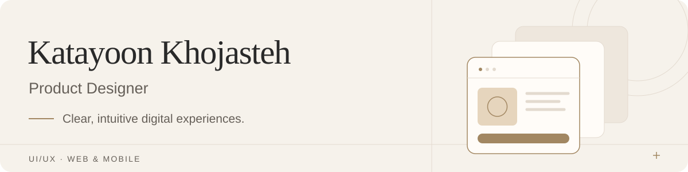
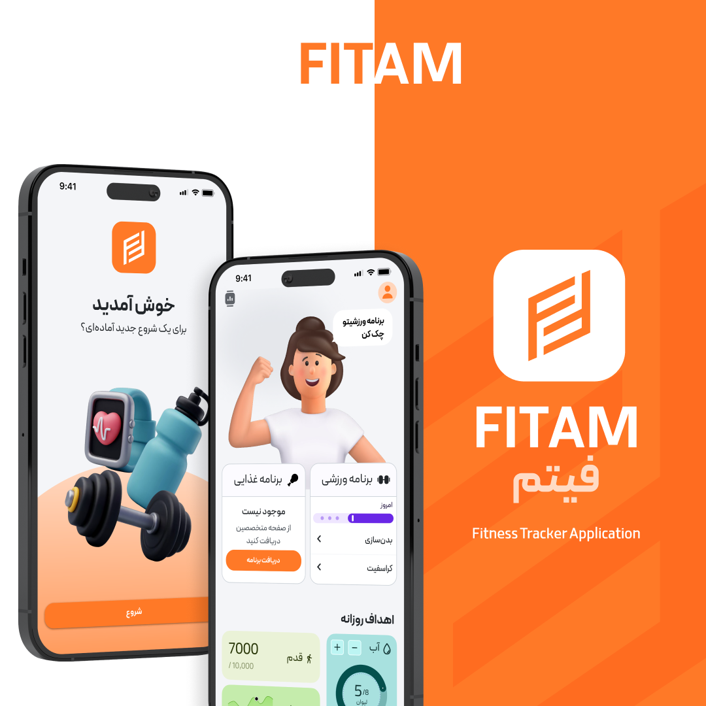
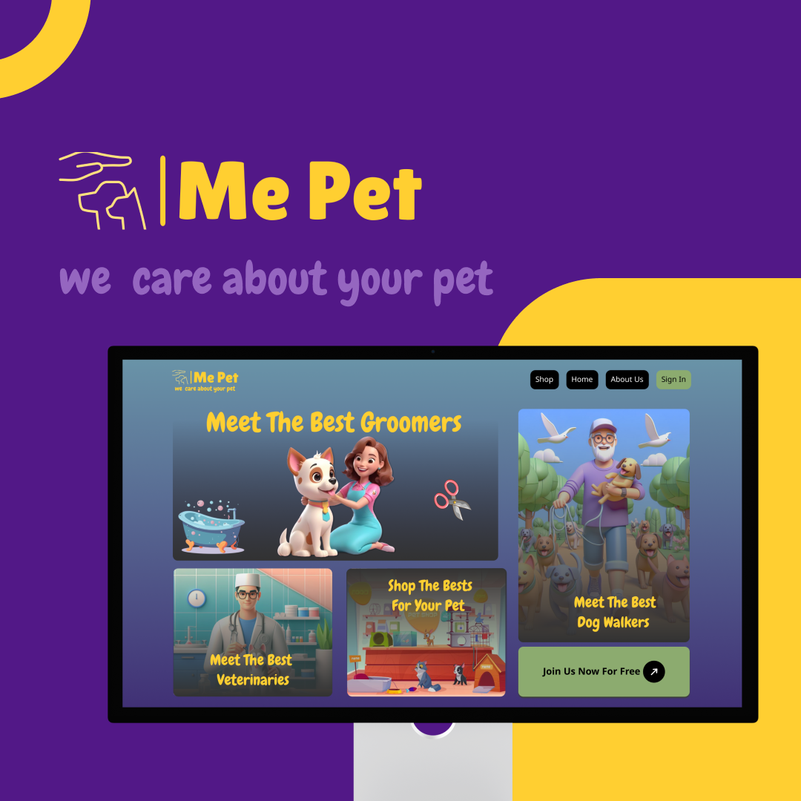

<a href="https://katayoonkhojasteh.com/">
  <picture>
    <source media="(prefers-color-scheme: dark)" srcset="assets/header-dark.svg">
    <source media="(prefers-color-scheme: light)" srcset="assets/header-light.svg">
    
  </picture>
</a>

I’m **Katayoon**, a **Product Designer** creating clear, intuitive interfaces for web and mobile.

**[Explore my portfolio ↗](https://katayoonkhojasteh.com/)**

### Selected work

<table>
  <tr>
    <td width="50%" valign="top">
      
      <h3><a href="https://katayoonkhojasteh.com/portfolio/fitam.html">Fitam ↗</a></h3>
      
Fitness and nutrition, with access to dietitians and coaches.

      
MOBILE APP

    </td>
    <td width="50%" valign="top">
      
      <h3><a href="https://katayoonkhojasteh.com/portfolio/mepet.html">MePet ↗</a></h3>
      
Pet care, veterinary services and everyday essentials.

      
WEB PLATFORM

    </td>
  </tr>
</table>

**[Akharin Khabar ↗](https://katayoonkhojasteh.com/portfolio/akharinkhabar.html)**  
UI/UX work for a news and content platform.

[View all projects →](https://katayoonkhojasteh.com/#portfolio)

### Design focus

UI/UX for web & mobile · Visual identity · Icons & illustration

### Let’s connect

[Email](mailto:khojasteh.katayoon@gmail.com) · [LinkedIn](https://www.linkedin.com/in/katayoon-khojasteh/) · [Dribbble](https://dribbble.com/katykh) · [Instagram](https://www.instagram.com/katayoon_khojasteh/)

